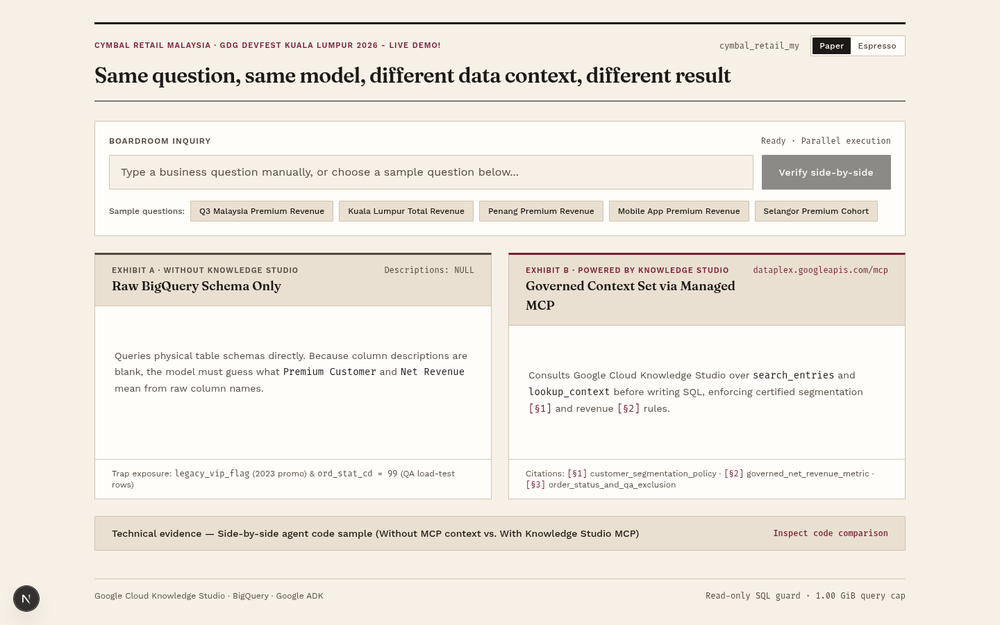

# Why Smart AI Agents Fail on Dumb Data (GDG DevFest Kuala Lumpur 2026)

Sample code from the **GDG DevFest Kuala Lumpur 2026** Builder Track live demo.

Same question, same model (`gemini-4-hydrogen`), different data context, different result:



When an AI agent queries raw BigQuery tables whose column descriptions are blank, it guesses from column names (`legacy_vip_flag = TRUE`, unfiltered status codes) and overstates Q3 2026 Premium Net Revenue as **RM 2,352,500.00** (+83.8% error).

When the exact same model and BigQuery tools are connected to **Google Cloud Knowledge Catalog & Knowledge Studio** via the managed Remote MCP server (`https://dataplex.googleapis.com/mcp`), the agent looks up the governed Context Set and Business Glossary first and returns the certified figure: **RM 1,280,000.00**.

---

## 1. What Changes in the Code?

Both agents live in [`backend/agent/app/builders.py`](backend/agent/app/builders.py) and share the same `gemini-4-hydrogen` model and read-only BigQuery tools (`inspect_bigquery_schema` and `run_readonly_bigquery_sql`). Only the Knowledge Catalog MCP toolset and grounding prompt differ:

```python
from google.adk.agents import Agent
from google.adk.tools.mcp_tool import McpToolset
from google.adk.tools.mcp_tool.mcp_session_manager import StreamableHTTPConnectionParams

# Agent 1: Raw BigQuery schema only (guesses column meanings)
agent_1_without_kc = Agent(
    name="agent_1_without_kc",
    model=DEFAULT_MODEL,
    instruction=WITHOUT_KC_INSTRUCTION,
    tools=[
        inspect_bigquery_schema,
        run_readonly_bigquery_sql,
    ],
)

# Agent 2: Grounded in Google Cloud Knowledge Studio via Managed Remote MCP
kc_mcp = McpToolset(
    connection_params=StreamableHTTPConnectionParams(
        url="https://dataplex.googleapis.com/mcp",
    ),
    tool_filter=["search_entries", "lookup_context"],
    header_provider=get_knowledge_catalog_mcp_headers,
)

agent_2_with_kc = Agent(
    name="agent_2_with_kc",
    model=DEFAULT_MODEL,
    instruction=WITH_KC_INSTRUCTION,
    tools=[
        kc_mcp,
        inspect_bigquery_schema,
        run_readonly_bigquery_sql,
    ],
)
```

---

## 2. The 3 Schema Traps in `cymbal_retail_my`

`make seed` creates a synthetic retail dataset (`cymbal_retail_my`) in BigQuery with blank physical column descriptions, plus the governed policies in Knowledge Studio:

| Trap in Raw BigQuery | What the Ungrounded Agent Guesses | Governed Rule in Knowledge Studio |
| :--- | :--- | :--- |
| `users.legacy_vip_flag` (`BOOL`) | Filters `WHERE legacy_vip_flag = TRUE` (a frozen 2023 campaign column containing TikTok Ads signups, underage users, and QA bots). | Never use `legacy_vip_flag`. A **Premium Customer** requires `traffic_source = 'Email'`, `age >= 35`, and at least 1 completed order (`ord_stat_cd = 1`). |
| `orders_raw_v2.ord_stat_cd` (`INT64`) | Sums across all rows or misses status `99`, accidentally counting a **RM 420,000** engineering load-test row plus returned (`2`) and cancelled (`9`) orders. | Filter strictly to `ord_stat_cd = 1` (Completed & Settled). Exclude `2` (Returned), `9` (Cancelled), and `99` (QA Load-Test Sandbox). |
| `amt_gross_myr` vs `disc_myr` | May sum gross order value without subtracting promotional discounts. | Compute Governed Net Revenue as `SUM(amt_gross_myr - disc_myr)` where `ord_stat_cd = 1`. |

---

## 3. Repository Structure

```text
.
├── backend/
│   ├── agent/                      # Google ADK Python package (3 selectable agents)
│   │   ├── agent_1_without_kc/     # Agent 1: Raw BigQuery schema only
│   │   ├── agent_2_with_kc/        # Agent 2: Powered by Knowledge Studio MCP
│   │   └── app/                    # Shared builders, BigQuery tools, kc_mcp.py, and Referee
│   └── src/api/                    # FastAPI concurrent SSE runner (/api/v1/agent/arena-stream)
├── frontend/                       # Next.js 15 side-by-side comparison UI (Paper & Espresso themes)
├── scripts/
│   ├── seed_demo.py                # One-command BigQuery + Knowledge Studio / Glossary seeder
│   └── warmup_demo.py              # Optional OAuth + MCP schema cache warmer
├── .env.example                    # Environment variable template
└── Makefile                        # Developer shortcuts (install, seed, playground, backend, frontend)
```

---

## 4. Quick Start (Run in Your Own Google Cloud Project)

### Prerequisites
1. A Google Cloud project with Billing enabled.
2. Python `3.12+` with [`uv`](https://docs.astral.sh/uv/), Node.js `24+`, and the [`gcloud` CLI](https://cloud.google.com/sdk/docs/install).

### Step 1: Authenticate & Enable Google Cloud APIs + Remote MCP
```bash
export GCP_PROJECT_ID="your-gcp-project-id"

gcloud auth login
gcloud auth application-default login
gcloud config set project "$GCP_PROJECT_ID"
gcloud auth application-default set-quota-project "$GCP_PROJECT_ID"

# Enable BigQuery, Dataplex (Knowledge Catalog / Studio), Vertex AI, and Resource Manager
gcloud services enable \
  aiplatform.googleapis.com \
  bigquery.googleapis.com \
  dataplex.googleapis.com \
  cloudresourcemanager.googleapis.com \
  --project="$GCP_PROJECT_ID"

# Enable the managed Dataplex / Knowledge Catalog Remote MCP endpoint
gcloud beta services mcp enable dataplex.googleapis.com --project="$GCP_PROJECT_ID"
```

Ensure your user account (or service account) has BigQuery Data Owner / Job User, Vertex AI User, Dataplex Catalog Admin, Dataplex Content Admin (`roles/dataplex.contentAdmin` for Knowledge Studio Context Sets), and MCP Tool User (`roles/mcp.toolUser`).

### Step 2: Configure `.env` & Install Dependencies
```bash
cp .env.example .env
# Edit .env and replace <YOUR_GCP_PROJECT_ID> with your actual GCP project ID
```

Note on model selection: `.env.example` defaults `GEMINI_MODEL` to `gemini-4-hydrogen` (`GOOGLE_CLOUD_LOCATION="global"`). You can also set `GEMINI_MODEL="gemini-2.5-flash"` in `.env` if preferred.

```bash
make install
```

### Step 3: Seed BigQuery Tables & Knowledge Studio Context
```bash
make seed
```

`make seed` is idempotent. It creates `<YOUR_GCP_PROJECT_ID>.cymbal_retail_my` (`users` and `orders_raw_v2`), verifies the `RM 1,280,000.00` vs. `RM 2,352,500.00` SQL benchmark, attaches `@bigquery` table overview aspects, creates the Business Glossary, and provisions the Knowledge Studio Context Set (`cymbal_retail_my_context_set`).

### Step 4: Run the Demo

**Option A: Full Side-by-Side Web UI (FastAPI SSE + Next.js)**

Open two terminals:
```bash
# Terminal 1: Start FastAPI backend on http://127.0.0.1:8080 (also mounts ADK UI at /dev-ui/)
make backend

# Terminal 2: Start Next.js UI on http://localhost:3000
make frontend
```

Open `http://localhost:3000`, click one of the 5 sample questions to populate the inquiry box, and click **Verify side-by-side**. Expand the two bottom drawers to inspect the live SQL diff, MCP tool calls, and ADK Python code.

**Option B: Standalone Google ADK Web Playground (`adk web`)**
```bash
make playground
```

Open `http://127.0.0.1:8081` and switch between `agent_1_without_kc`, `agent_2_with_kc`, and `app` (the head-to-head referee) in the top-left agent dropdown.

---

## 5. Sample Questions & Expected MYR Benchmarks

All 5 built-in sample inquiries produce deterministic results against the seeded Q3 2026 (`2026-07-01` to `2026-09-30`) ledger:

| Sample Button | Question | Without Knowledge Studio (Ungrounded) | Powered by Knowledge Studio (Governed) | Root Cause of Variance |
| :--- | :--- | :--- | :--- | :--- |
| Q3 Malaysia Premium Revenue | What was our Q3 2026 Net Revenue from Premium Customers in Malaysia? | `RM 2,352,500.00` (or `RM 1,842,500.00`) | `RM 1,280,000.00` | Stale `legacy_vip_flag` + `ord_stat_cd` `2`, `9`, and `99` QA row |
| Kuala Lumpur Total Revenue | What was our Q3 2026 Total Revenue from Kuala Lumpur customers? | `RM 1,080,000.00` | `RM 620,000.00` | Includes `RM 420,000` `ord_stat_cd = 99` QA load-test bot + `RM 40,000` returned order |
| Penang Premium Revenue | What was our Q3 2026 Net Revenue from Premium Customers in Penang? | `RM 665,000.00` | `RM 335,000.00` | Includes `Paid_Search` `legacy_vip_flag` user + `RM 50,000` cancelled order |
| Mobile App Premium Revenue | What was our Q3 2026 Net Revenue from Premium Customers on the Mobile_App channel in Malaysia? | `RM 950,000.00` | `RM 620,000.00` | Includes underage (`age = 27`) legacy VIP + cancelled Mobile_App checkout |
| Selangor Premium Cohort | What was our Q3 2026 Net Revenue from Premium Customers in Selangor? | `RM 322,500.00` (wrong customer: `Nurul Huda`, `TikTok_Ads`) | `RM 320,000.00` (true customer: `Priya Nair`, `Email`) | Silent cohort swap: real Premium customer had `legacy_vip_flag = FALSE` |

---

## 6. Running Tests & Typechecks Offline

```bash
make test
make lint
```

---

## License

Licensed under the [Apache License 2.0](LICENSE).
